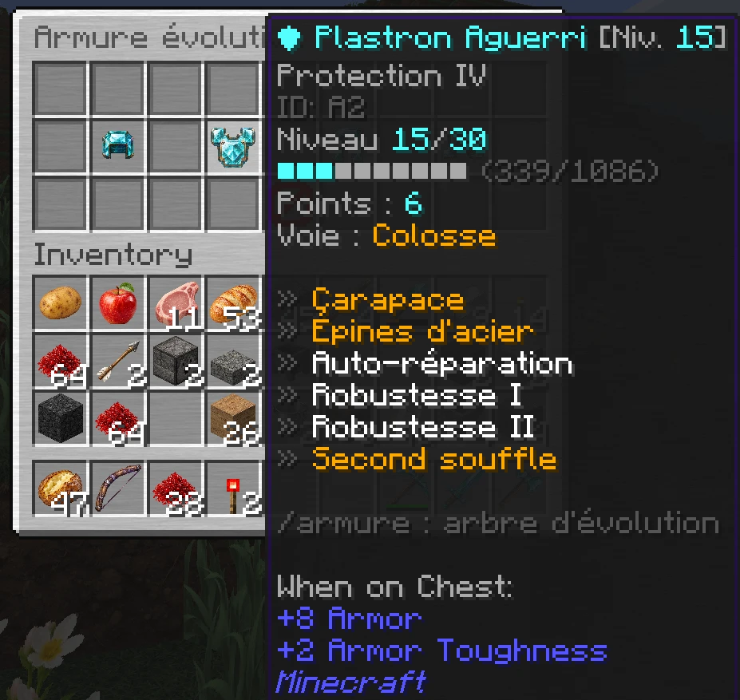

# Armure a niveaux

**Prix :** 6,99 EUR

Ton armure monte en niveau avec toi : chaque pièce gagne de l'XP et débloque ses pouvoirs.

- 4 pièces, 4 arbres de pouvoirs custom (aucun enchantement vanilla) : casque, plastron, jambières et bottes, chacun avec 2 voies exclusives (Sentinelle / Stratège, Colosse / Phénix, Titan / Ombre, Vent / Magma).
- Ultimes automatiques en combat : Renaissance (survis à un coup mortel), Bastion, Disparition, Éruption, Regard pétrifiant...
- Pouvoirs uniques : invisibilité totale (armure comprise, les monstres t'oublient), double saut, marche sur la lave, monstres visibles à travers les murs (pour toi seul).
- Évolution du matériau : maille, fer, diamant puis Netherite (points + vrais matériaux).
- Effets discrets : aucune icône ni particule de potion à l'écran.
- Équilibré pour le multijoueur : XP seulement en combattant (pas de farm AFK), réductions de dégâts plafonnées.

Menu : /armure. Nécessite skript-reflect et le script gratuit Surbrillance privée (glow-prive).

## Apercus en jeu

---

Script protege OxoSK, chiffre et charge par le plugin CoreOxoSK. Fichier : `armure-niveaux.enc`.
