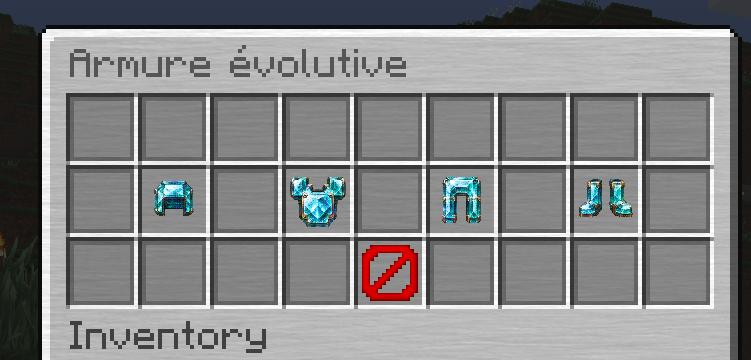
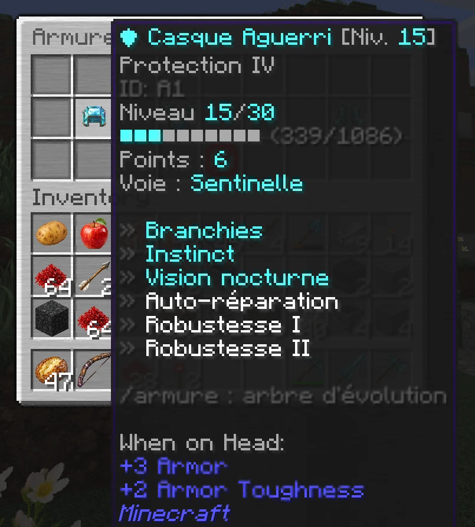
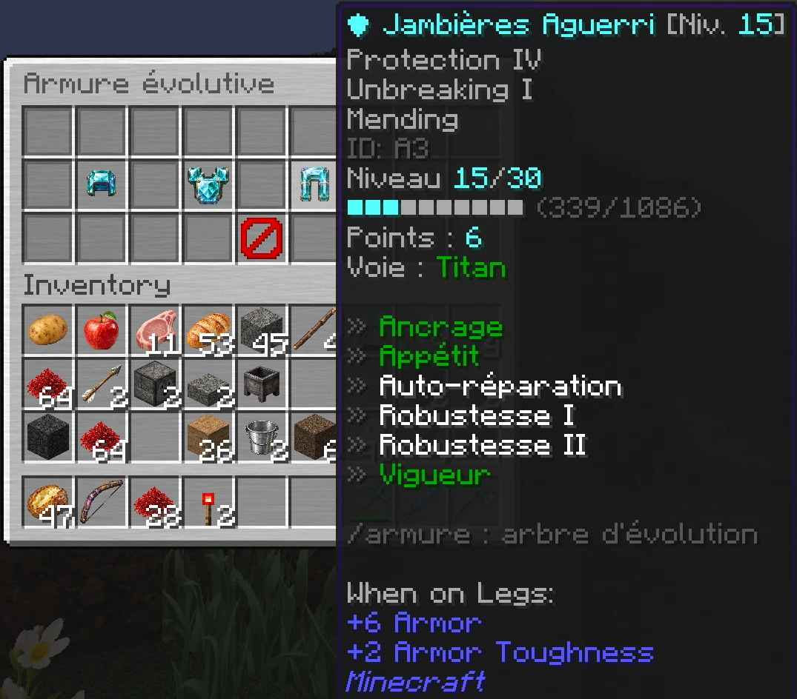
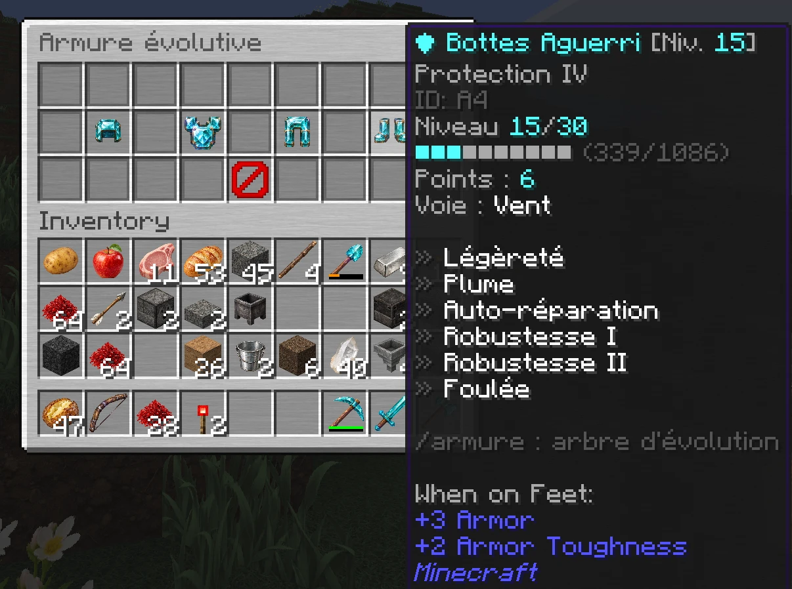
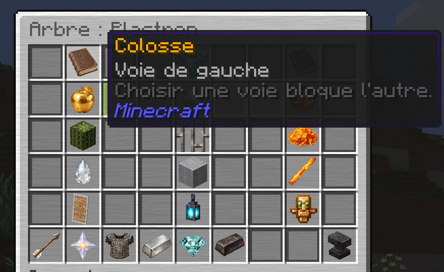

# Armure a niveaux

**Prix :** 6,99 EUR

Chaque pièce d'armure gagne de l'XP et monte en niveau. Dépense tes points dans un arbre de pouvoirs custom (auto-réparation, lien d'âme, ultimes qui se déclenchent en situation critique) et fais évoluer ton équipement de la maille à la Netherite. Menu : /armure.

## Apercus en jeu

---

Script protege OxoSK, chiffre et charge par le plugin CoreOxoSK. Fichier : `armure-niveaux.enc`.
