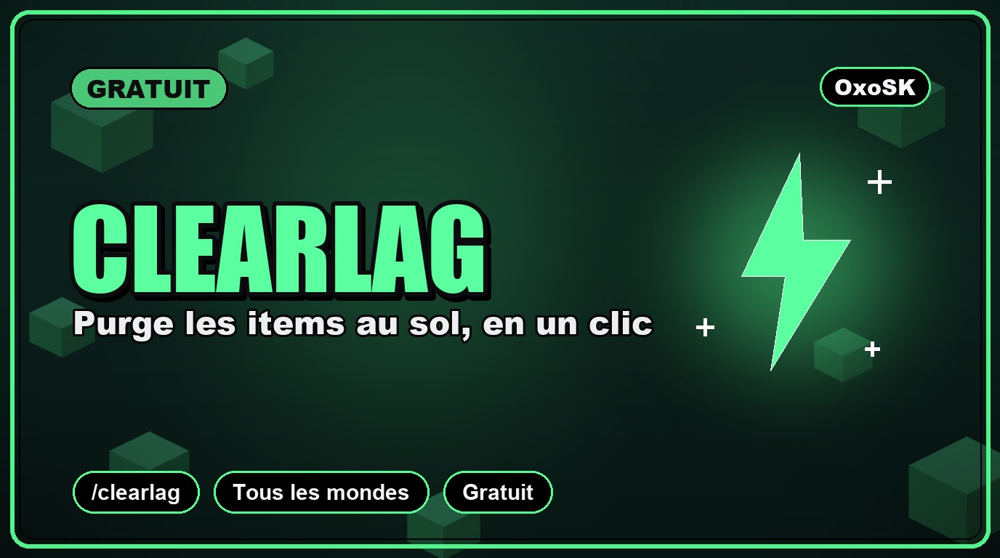

# ClearLag

**Prix :** Gratuit

Purge en un clic tous les items au sol de tous les mondes pour soulager ton serveur. Commande /clearlag (ou /cl), protégée par permission, avec le nombre d'items supprimés annoncé.

## Apercus en jeu

---

Script protege OxoSK, chiffre et charge par le plugin CoreOxoSK. Fichier : `clearlag.enc`.
