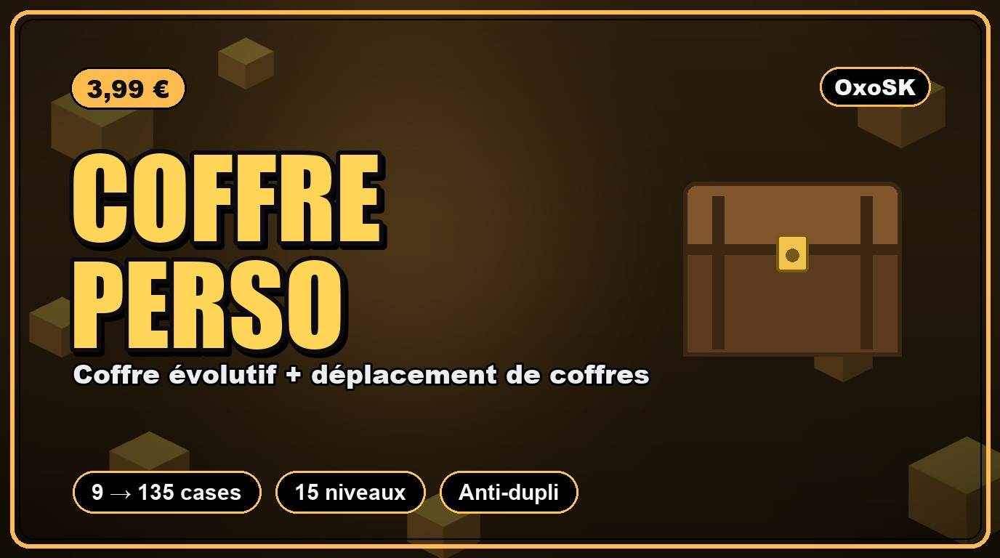

# Coffre personnel et deplacement de coffres

**Prix :** 3,99 EUR

Un coffre personnel accessible partout, qui grandit avec le joueur : de 9 à 135 cases sur 15 niveaux et 3 pages. Inclut aussi le déplacement des coffres pleins.

- Ouverture avec /coffre, ou accroupi + clic droit sur un coffre de l'Ender.
- Ligne d'options intégrée : infos et progression, pages, Déposer, Récupérer, Trier, Paramètres, Améliorer.
- Déposer (objets déjà présents ou tout l'inventaire), Récupérer (toute la page ou compléter tes piles), Trier (regroupe et trie).
- Menu Paramètres par joueur : sons, tri automatique, coffre de l'Ender, confirmation des achats, barre rapide, dernière page, couleur de la ligne d'options, langue.
- Français et anglais : langue détectée depuis Minecraft, modifiable par joueur (/coffre langue) ou pour tout le serveur.
- Améliorations payées en XP et en vrais matériaux : fer, or, diamant puis netherite.
- Bonus de rangées par permission (coffre.bonus.1 à 5) pour les grades VIP.
- Anti-duplication : sauvegarde à chaque clic, une seule ouverture à la fois, aucun objet perdu ni dupliqué en cas de crash.
- Anti-abus : coffre inaccessible en combat, shulkers et sacs refusés (option).
- Déplacement de coffres : accroupi + clic droit main vide sur un coffre, coffre piégé ou tonneau pour le ramasser avec tout son contenu, repose-le pour tout restaurer. Les coffres doubles donnent 2 moitiés liées.
- Respecte les protections (claims, WorldGuard...) : impossible de déplacer un coffre qu'on n'a pas le droit de casser.
- Admin : /coffre voir (même hors ligne), /coffre niveau, /coffre historique, avec autocomplétion (Tab).

Nécessite skript-reflect et SkBee.

## Apercus en jeu

---

Script protege OxoSK, chiffre et charge par le plugin CoreOxoSK. Fichier : `coffre-perso.enc`.
