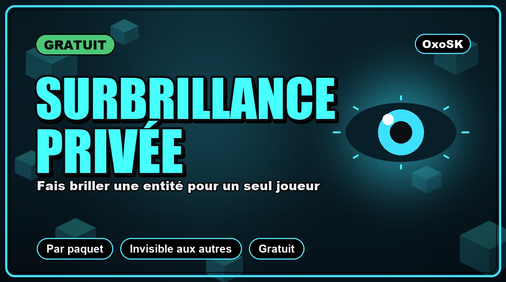

# Surbrillance privee

**Prix :** Gratuit

Fais briller le contour d'une entité pour un seul joueur, via paquet réseau : invisible pour le serveur et les autres joueurs. La brique technique derrière les pouvoirs de détection (Instinct, Marque du chasseur, Sonar). Nécessite skript-reflect.

## Apercus en jeu

---

Script protege OxoSK, chiffre et charge par le plugin CoreOxoSK. Fichier : `glow-prive.enc`.
